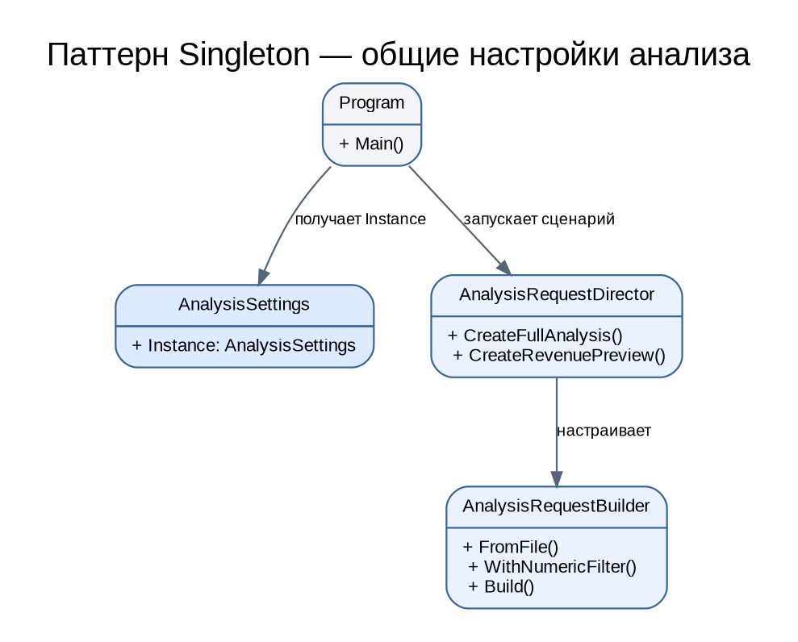
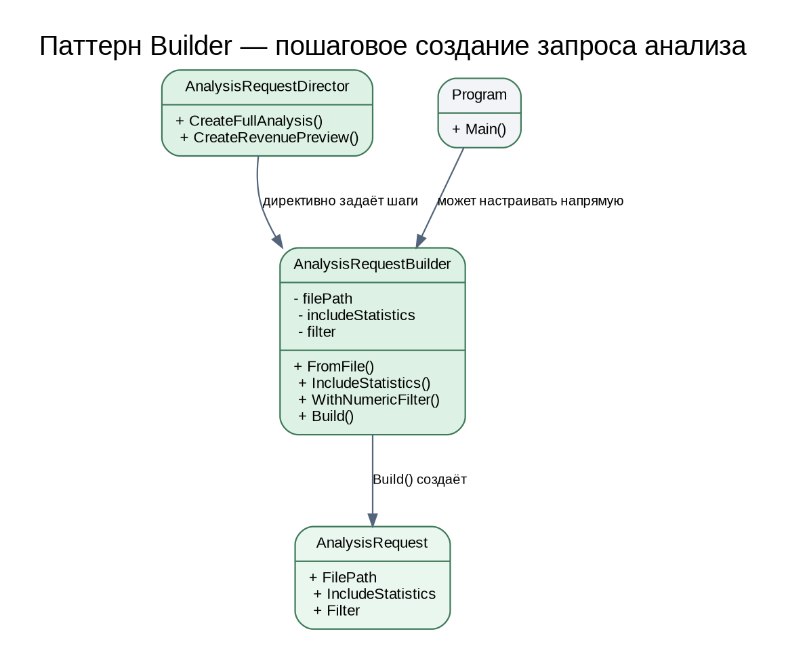

# Лабораторная работа №1

**Дисциплина:** Паттерны проектирования  
**Тема:** Порождающие паттерны: Одиночка (Singleton), Строитель (Builder)  
**Выполнил:** Никита Фуфаев, 4 курс, группа __________  
**Проверил:** ______________________________  
**Направление подготовки:** 09.03.04 «Программная инженерия»  
**Учебное заведение:** Северо-Кавказский федеральный университет  
**Место и год:** Ставрополь, 2026 г.

**Оценка за защиту:** ____________  
**Дата защиты:** ____________  
**Подписи:** студент ____________ · преподаватель ____________

---

**Цель работы:** изучить назначение порождающих паттернов и применить их для создания объектов и управления конфигурацией приложения анализа данных.

**Задание:** реализовать прикладное решение для предметной области согласно варианту, используя паттерн «Одиночка» или «Строитель». В программе показано совместное применение обоих паттернов: Singleton централизует настройки, Builder создаёт конфигурацию запроса.

**Вариант 13** — «Интерактивный анализ набора данных».

Приложение загружает табличные данные CSV, проверяет структуру, позволяет сформировать запрос анализа с фильтром и рассчитывает статистические показатели.

## 1. Архитектура решения

Решение разделено на общую библиотеку `DataLensPatterns.Core` и демонстрационную программу лабораторной. Общая библиотека отвечает за модель таблицы, загрузку CSV, проверку ограничений, расчёт статистики и фильтрацию. Код паттернов находится в `SRC/Builder` и `SRC/Patterns`.

| Компонент | Назначение |
|---|---|
| `AnalysisSettings` | Единственный экземпляр общих настроек: лимит строк, столбцов и кодировка |
| `AnalysisRequest` | Готовый объект запроса анализа |
| `AnalysisRequestBuilder` | Пошагово формирует запрос и проверяет обязательные параметры |
| `AnalysisRequestDirector` | Создаёт типовые конфигурации полного анализа и просмотра выручки |
| `Program` | Демонстрирует паттерны и вызывает сервисы общей библиотеки |
| `DatasetAnalyzer` | Рассчитывает характеристики столбцов и выполняет фильтрацию |

## 2. Используемые технологии

- C# 12 и .NET 8;
- консольное приложение без внешних NuGet-зависимостей;
- общая библиотека `DataLensPatterns.Core`;
- UML-диаграммы классов в PNG и редактируемом Graphviz DOT.

## 3. Паттерн «Одиночка» (Singleton)

Singleton гарантирует существование одного экземпляра класса и предоставляет общую точку доступа к нему. В проекте `AnalysisSettings` хранит централизованные ограничения анализа: максимум 20 000 строк, 100 столбцов и кодировку UTF-8. Это исключает создание нескольких объектов настроек с потенциально различающимися значениями.

Конструктор класса закрытый. Объект создаётся через `Lazy<AnalysisSettings>`, а публичное свойство `Instance` возвращает один и тот же экземпляр.

| Роль | Класс / член | Ответственность |
|---|---|---|
| Singleton | `AnalysisSettings` | Хранит общие настройки анализа |
| Хранилище экземпляра | `Holder: Lazy<AnalysisSettings>` | Ленивое создание объекта |
| Точка доступа | `Instance` | Возвращает единственный экземпляр |
| Клиент | `Program`, `AnalysisRequestBuilder` | Читает общие настройки и использует их при обработке |



*Рисунок 1 — Диаграмма классов паттерна «Одиночка».*

Ключевой фрагмент:

```csharp
public sealed class AnalysisSettings
{
    private static readonly Lazy<AnalysisSettings> Holder =
        new(() => new AnalysisSettings());

    private AnalysisSettings() { }
    public static AnalysisSettings Instance => Holder.Value;

    public int MaxRows { get; } = 20000;
    public int MaxColumns { get; } = 100;
    public string DefaultEncoding { get; } = "UTF-8";
}
```

В `Program` свойство `Instance` запрашивается дважды. `ReferenceEquals(settings1, settings2)` должно вернуть `True`, что демонстрирует единственность объекта.

## 4. Паттерн «Строитель» (Builder)

`AnalysisRequest` объединяет несколько параметров: путь к файлу, необходимость статистического анализа и необязательный числовой фильтр. Создание такого объекта вынесено в `AnalysisRequestBuilder`. Параметры задаются последовательными вызовами методов `FromFile`, `IncludeStatistics` и `WithNumericFilter`. Метод `Build()` проверяет наличие пути к файлу и допустимость диапазона фильтра, после чего создаёт готовый объект запроса.

`AnalysisRequestDirector` хранит две типовые последовательности действий: полный анализ и предварительный просмотр выручки в диапазоне 20 000–90 000.

| Роль | Класс | Ответственность |
|---|---|---|
| Product | `AnalysisRequest` | Готовый запрос анализа |
| Builder | `AnalysisRequestBuilder` | Пошаговая настройка и создание запроса |
| Director | `AnalysisRequestDirector` | Предустановленные сценарии построения |
| Client | `Program` | Получает готовый запрос и выполняет его |



*Рисунок 2 — Диаграмма классов паттерна «Строитель».*

Ключевой фрагмент:

```csharp
var request = new AnalysisRequestBuilder()
    .FromFile(samplePath)
    .IncludeStatistics(true)
    .WithNumericFilter("revenue", 20000, 90000)
    .Build();
```

Преимущество Builder состоит в том, что сложный запрос создаётся постепенно, а клиент не обязан передавать длинный список параметров в один конструктор.

## 5. Модель данных и сценарий анализа

Для демонстрации используется `datasets/sample_sales.csv`: 10 записей о продажах, 6 столбцов (`id`, `region`, `product`, `units`, `revenue`, `discount`). В исходном файле 60 ячеек, из них 2 пропущены; исходная заполненность составляет 96,67%.

Сценарий `CreateRevenuePreview` задаёт фильтр `revenue` от 20 000 до 90 000 включительно. В диапазон попадает 8 записей. После фильтрации остаётся одна пропущенная ячейка из 48, поэтому заполненность выборки равна 97,92%. Для `revenue`: минимум 24 000, максимум 90 000, среднее 51 937,50, медиана 49 000.

## 6. Проверка корректности

- два обращения к `AnalysisSettings.Instance` должны возвращать один объект;
- вызов `Build()` без пути к файлу должен завершаться контролируемой ошибкой;
- диапазон с минимумом больше максимума должен отклоняться;
- корректный сценарий должен формировать запрос с фильтром `revenue` 20 000–90 000;
- итоговая выборка должна содержать 8 строк и 6 столбцов.

Контрольные значения приведены по демонстрационному CSV. Компиляция и фактический запуск .NET-программы должны быть выполнены на ПК с установленным .NET 8 SDK; упаковочная среда не содержит .NET SDK, поэтому вывод консоли ниже не выдаётся за снятый runtime-лог.

```text
[Singleton]
Один экземпляр настроек: True
Лимиты: строк=20000, столбцов=100, кодировка=UTF-8

[Builder]
Фильтр: revenue от 20 000 до 90 000
Результат: 8 строк, 6 столбцов, заполненность 97.92%
revenue: min=24 000; max=90 000; среднее=51 937.50; медиана=49 000
```

## 7. Вывод

В лабораторной работе реализованы Singleton для централизованного хранения настроек и Builder для пошагового создания запроса анализа. Паттерны имеют отдельные обязанности и не смешивают создание запроса с выполнением операций загрузки и анализа.

## 8. Состав папки

- `SRC/` — исходный код C# и файл проекта;
- `UML/` — диаграммы паттернов и исходники DOT;
- `assets/` — контрольный пример вывода и материалы данных;
- `Reports/` — формальный отчёт DOCX/PDF;
- `START_PROJECT.bat` — запуск демонстрации.
