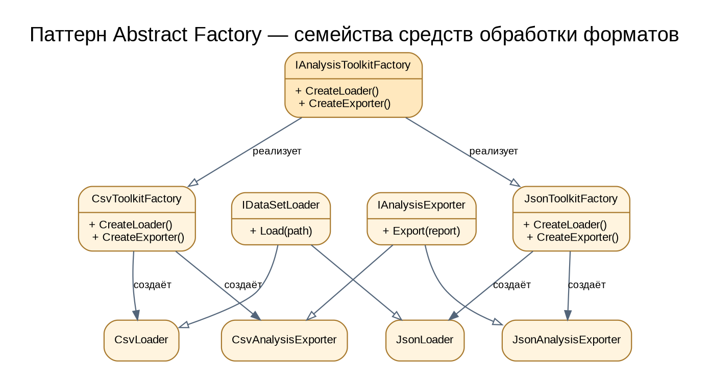
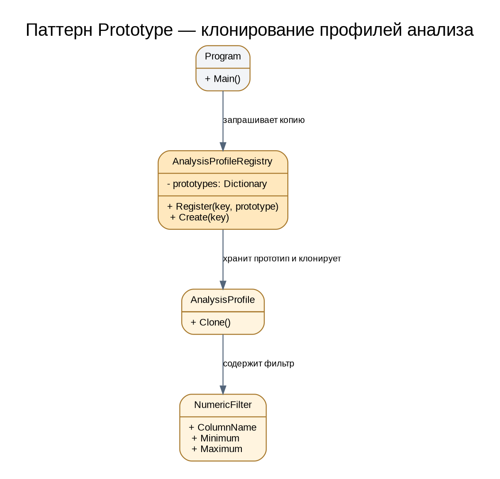

# Лабораторная работа №2

**Дисциплина:** Паттерны проектирования  
**Тема:** Порождающие паттерны: Абстрактная фабрика (Abstract Factory), Прототип (Prototype)  
**Выполнил:** Никита Фуфаев, 4 курс, группа __________  
**Проверил:** ______________________________  
**Направление подготовки:** 09.03.04 «Программная инженерия»  
**Учебное заведение:** Северо-Кавказский федеральный университет  
**Место и год:** Ставрополь, 2026 г.

**Оценка за защиту:** ____________  
**Дата защиты:** ____________  
**Подписи:** студент ____________ · преподаватель ____________

---

**Цель работы:** изучить порождающие паттерны, которые позволяют создавать связанные объекты и копировать готовые конфигурации без привязки клиентского кода к конкретным реализациям.

**Задание:** реализовать предметную задачу с использованием двух паттернов из списка: «Абстрактная фабрика», «Фабричный метод», «Прототип». В данной работе выбраны Abstract Factory и Prototype.

**Вариант 13** — «Интерактивный анализ набора данных».

## 1. Архитектура решения

Приложение демонстрирует два семейства средств обработки данных: CSV и JSON. Каждое семейство предоставляет совместимые загрузчик и экспортёр аналитического отчёта. Отдельный каталог прототипов хранит повторно используемые профили анализа.

| Компонент | Назначение |
|---|---|
| `IAnalysisToolkitFactory` | Абстрактная фабрика, объявляющая создание загрузчика и экспортёра |
| `CsvToolkitFactory` | Создаёт продукты для формата CSV |
| `JsonToolkitFactory` | Создаёт продукты для формата JSON |
| `IDataSetLoader` | Абстракция загрузчика набора данных |
| `IAnalysisExporter` | Абстракция экспортёра аналитического отчёта |
| `AnalysisProfile` | Прототип профиля: имя, набор столбцов и фильтр |
| `AnalysisProfileRegistry` | Регистрирует прототипы и создаёт их независимые копии |

## 2. Используемые технологии

- C# 12 и .NET 8;
- `System.Text.Json` для чтения JSON и сериализации результатов;
- общий CSV-загрузчик из `DataLensPatterns.Core`;
- UML-диаграммы классов в Graphviz DOT и PNG.

## 3. Паттерн «Абстрактная фабрика» (Abstract Factory)

Абстрактная фабрика предоставляет интерфейс для создания семейств взаимосвязанных объектов. Клиент обращается к `IAnalysisToolkitFactory` и получает загрузчик через `CreateLoader()` и экспортёр через `CreateExporter()`. Он не обязан знать конкретные классы продуктов.

В программе существуют две конкретные фабрики. `CsvToolkitFactory` создаёт `CsvLoader` и `CsvAnalysisExporter`; `JsonToolkitFactory` создаёт `JsonLoader` и `JsonAnalysisExporter`. Таким образом, загрузчик и экспортёр принадлежат одному семейству формата.

| Роль | Класс / интерфейс | Ответственность |
|---|---|---|
| Abstract Factory | `IAnalysisToolkitFactory` | Контракт создания совместимых продуктов |
| Concrete Factory | `CsvToolkitFactory` | Создание CSV-загрузчика и CSV-экспортёра |
| Concrete Factory | `JsonToolkitFactory` | Создание JSON-загрузчика и JSON-экспортёра |
| Abstract Product | `IDataSetLoader` | Общий интерфейс загрузки данных |
| Abstract Product | `IAnalysisExporter` | Общий интерфейс экспорта отчёта |



*Рисунок 1 — Диаграмма классов паттерна «Абстрактная фабрика».*

Ключевой фрагмент:

```csharp
public interface IAnalysisToolkitFactory
{
    IDataSetLoader CreateLoader();
    IAnalysisExporter CreateExporter();
}

IAnalysisToolkitFactory factory = new CsvToolkitFactory();
var dataset = factory.CreateLoader().Load(path);
var report = analyzer.Analyze(dataset);
var export = factory.CreateExporter().Export(report);
```

JSON-загрузчик ожидает JSON-массив объектов с общей структурой свойств. Экспортёр JSON формирует читаемый JSON-объект с параметрами отчёта и статистикой по столбцам.

## 4. Паттерн «Прототип» (Prototype)

Prototype позволяет создавать новые объекты путём копирования зарегистрированного образца. `AnalysisProfile` хранит имя профиля, изменяемый список выбранных столбцов и необязательный числовой фильтр. Метод `Clone()` создаёт новый профиль, копирует список столбцов и отдельно создаёт новый объект `NumericFilter`. Поэтому копия не разделяет изменяемый список с исходным профилем.

`AnalysisProfileRegistry` хранит прототипы в словаре. Метод `Register()` сохраняет копию переданного профиля, а `Create()` возвращает новую копию зарегистрированного образца. Неизвестный ключ приводит к `KeyNotFoundException`.

| Роль | Класс | Ответственность |
|---|---|---|
| Prototype | `AnalysisProfile` | Содержит конфигурацию анализа и умеет клонироваться |
| Prototype Registry | `AnalysisProfileRegistry` | Регистрирует образцы и создаёт их копии |
| Client | `Program` | Запрашивает новый профиль и изменяет его независимо |



*Рисунок 2 — Диаграмма классов паттерна «Прототип».*

Ключевой фрагмент:

```csharp
public AnalysisProfile Clone() => new(
    Name + " (копия)",
    SelectedColumns.ToList(),
    Filter is null ? null : new NumericFilter(
        Filter.ColumnName, Filter.Minimum, Filter.Maximum));
```

## 5. Контрольные данные и результат

Для CSV и JSON используется один логический демонстрационный набор продаж: 10 строк, 6 столбцов, 2 пропущенных значения. Анализ обоих форматов должен показывать заполненность 96,67%.

В сценарии Prototype исходный профиль выбирает столбцы `region`, `product`, `revenue`. После клонирования в список копии добавляется `discount`. Исходный профиль остаётся неизменным, а `ReferenceEquals(profileA.SelectedColumns, profileB.SelectedColumns)` возвращает `False`.

```text
[Abstract Factory: CSV]
Фабрика создала совместимые продукты: 10 строк

[Abstract Factory: JSON]
Загружено: 10 строк; заполненность=96.67%

[Prototype]
Исходный профиль: region, product, revenue
Копия профиля: region, product, revenue, discount
Списки независимы: True
```

## 6. Проверка корректности

- CSV-фабрика должна создавать пару CSV-совместимых продуктов;
- JSON-фабрика должна читать JSON-массив объектов;
- результаты анализа CSV и JSON должны совпадать по количеству строк, столбцов и пропусков;
- изменение списка столбцов копии не должно менять список оригинала;
- запрос незарегистрированного ключа прототипа должен завершаться контролируемым исключением.

Значения выше являются контрольными ожиданиями по приложенным файлам. В среде подготовки отсутствует .NET SDK, поэтому компиляцию и runtime-лог необходимо подтвердить запуском на машине с .NET 8 SDK.

## 7. Вывод

В лабораторной работе реализована Абстрактная фабрика для создания семейств загрузчиков и экспортёров CSV/JSON, а также Прототип для быстрого получения независимых профилей анализа. Клиентский код зависит от абстракций и не связан напрямую с реализациями отдельных форматов.

## 8. Состав папки

- `SRC/` — фабрики, интерфейсы продуктов, прототипы и клиентский код;
- `UML/` — две диаграммы и исходники DOT;
- `assets/` — контрольные данные и ожидаемый вывод;
- `Reports/` — формальный отчёт DOCX/PDF;
- `START_PROJECT.bat` — запуск демонстрации.
