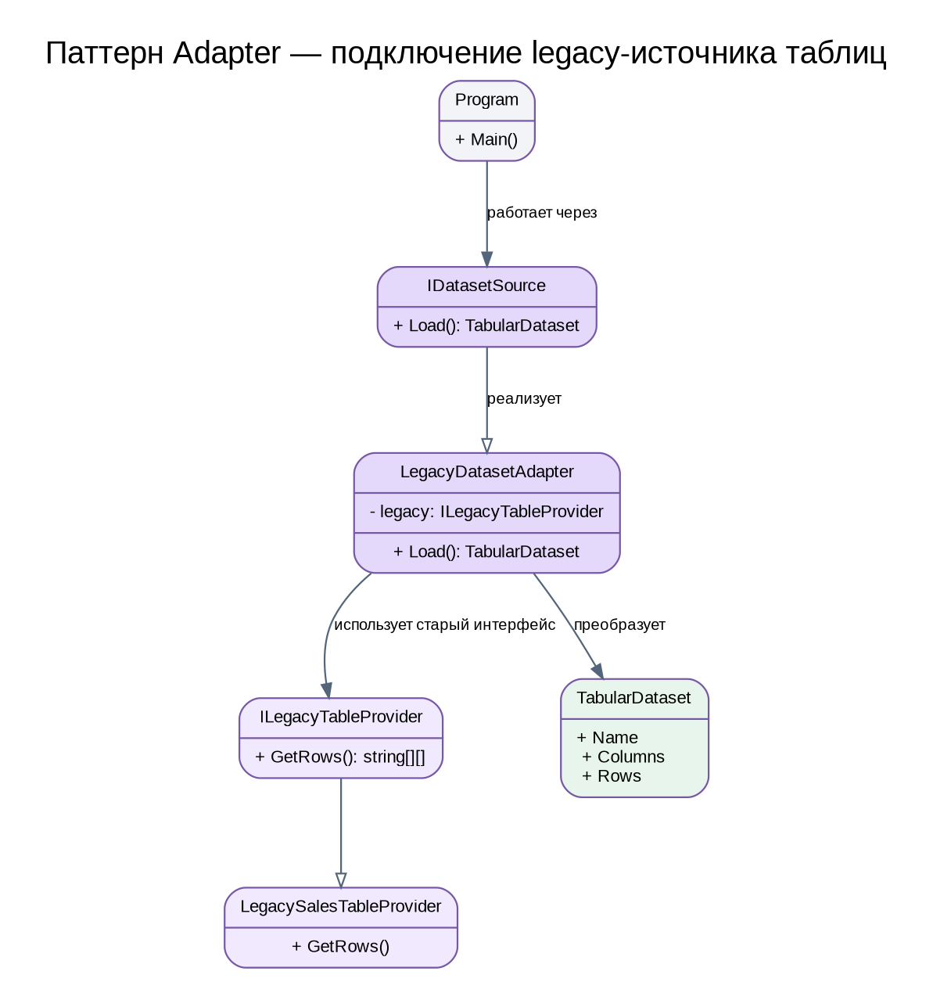
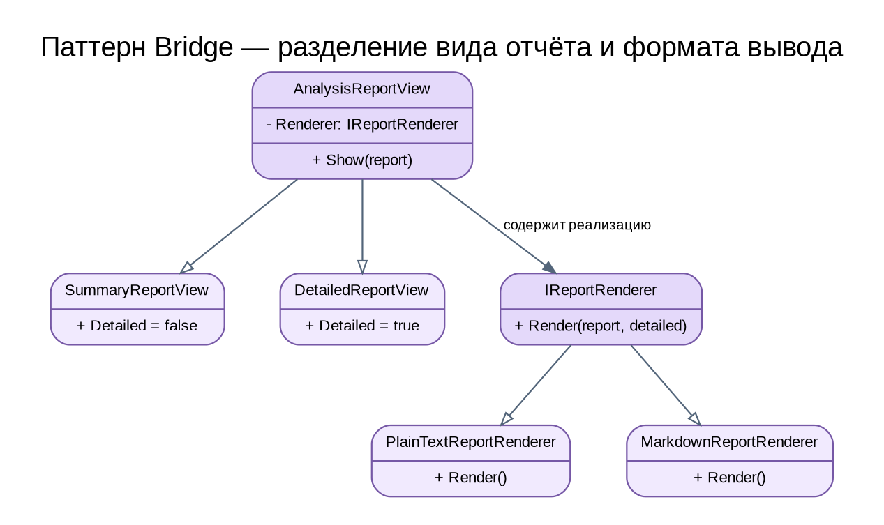

# Лабораторная работа №3

**Дисциплина:** Паттерны проектирования  
**Тема:** Структурные паттерны: Адаптер (Adapter), Мост (Bridge)  
**Выполнил:** Никита Фуфаев, 4 курс, группа __________  
**Проверил:** ______________________________  
**Направление подготовки:** 09.03.04 «Программная инженерия»  
**Учебное заведение:** Северо-Кавказский федеральный университет  
**Место и год:** Ставрополь, 2026 г.

**Оценка за защиту:** ____________  
**Дата защиты:** ____________  
**Подписи:** студент ____________ · преподаватель ____________

---

**Цель работы:** изучить структурные паттерны, обеспечивающие совместимость объектов с различными интерфейсами и независимое изменение абстракции и реализации.

**Задание:** реализовать предметную задачу варианта с использованием паттернов «Адаптер» и/или «Мост» из заданного списка. В решении показаны оба паттерна.

**Вариант 13** — «Интерактивный анализ набора данных».

## 1. Архитектура решения

В лабораторной работе показаны две задачи интеграции. Первая — подключение устаревшего источника, который возвращает данные в виде `string[][]`, к новой модели `TabularDataset`. Вторая — формирование отчётов с разным уровнем детализации и разными форматами вывода.

| Компонент | Назначение |
|---|---|
| `ILegacyTableProvider` | Старый контракт, возвращающий двумерный массив строк |
| `LegacySalesTableProvider` | Демонстрационный legacy-источник |
| `IDatasetSource` | Современный целевой интерфейс загрузки |
| `LegacyDatasetAdapter` | Преобразует `string[][]` в `TabularDataset` |
| `AnalysisReportView` | Абстракция представления отчёта |
| `SummaryReportView` | Краткий вид отчёта |
| `DetailedReportView` | Подробный вид отчёта |
| `IReportRenderer` | Абстракция формата вывода |
| `PlainTextReportRenderer`, `MarkdownReportRenderer` | Конкретные реализации форматирования |

## 2. Используемые технологии

- C# 12 и .NET 8;
- типизированные интерфейсы и объектная композиция;
- общая модель `TabularDataset` и сервис `DatasetAnalyzer`;
- UML-диаграммы Adapter и Bridge.

## 3. Паттерн «Адаптер» (Adapter)

Adapter позволяет использовать существующий класс с интерфейсом, несовместимым с ожидаемым клиентом. Legacy-источник реализует `ILegacyTableProvider` и выдаёт двумерный массив: первая строка содержит заголовки, остальные — записи. Современный код ожидает `IDatasetSource`, метод которого возвращает объект `TabularDataset`.

`LegacyDatasetAdapter` реализует целевой интерфейс, получает матрицу из старого источника, проверяет наличие заголовка и записей, проверяет количество полей в каждой строке, затем формирует словари значений и создаёт `TabularDataset`.

| Роль | Класс / интерфейс | Ответственность |
|---|---|---|
| Target | `IDatasetSource` | Современный интерфейс загрузки набора |
| Adapter | `LegacyDatasetAdapter` | Преобразование старого представления в новую модель |
| Adaptee | `ILegacyTableProvider` | Старый контракт `GetRows(): string[][]` |
| Concrete Adaptee | `LegacySalesTableProvider` | Предоставляет пример старой таблицы |
| Client | `Program` | Работает через `IDatasetSource` |



*Рисунок 1 — Диаграмма классов паттерна «Адаптер».*

Ключевой фрагмент:

```csharp
IDatasetSource source = new LegacyDatasetAdapter(
    new LegacySalesTableProvider());
TabularDataset dataset = source.Load();
```

Клиент не знает о внутреннем формате `string[][]` и получает стандартную модель данных.

## 4. Паттерн «Мост» (Bridge)

Bridge разделяет абстракцию и реализацию, чтобы их можно было изменять независимо. В приложении абстракция `AnalysisReportView` отвечает за вид представления: краткий или подробный. Реализация `IReportRenderer` отвечает за формат: обычный текст или Markdown.

`SummaryReportView` и `DetailedReportView` расширяют абстракцию, а `PlainTextReportRenderer` и `MarkdownReportRenderer` реализуют интерфейс рендерера. Поэтому можно сочетать разные виды представления с разными форматами вывода без создания отдельного класса для каждой комбинации.

| Роль | Класс / интерфейс | Ответственность |
|---|---|---|
| Abstraction | `AnalysisReportView` | Хранит ссылку на рендерер и вызывает его |
| Refined Abstraction | `SummaryReportView` | Выбирает краткий уровень детализации |
| Refined Abstraction | `DetailedReportView` | Выбирает подробный уровень детализации |
| Implementor | `IReportRenderer` | Контракт форматирования отчёта |
| Concrete Implementor | `PlainTextReportRenderer` | Формирует обычный текст |
| Concrete Implementor | `MarkdownReportRenderer` | Формирует Markdown |



*Рисунок 2 — Диаграмма классов паттерна «Мост».*

Ключевой фрагмент:

```csharp
var compact = new SummaryReportView(new PlainTextReportRenderer());
var detailed = new DetailedReportView(new MarkdownReportRenderer());
Console.WriteLine(compact.Show(report));
Console.WriteLine(detailed.Show(report));
```

## 5. Результат обработки legacy-таблицы

Демонстрационный старый источник содержит 5 записей и 6 столбцов. В столбце `discount` одна пустая ячейка. После преобразования в `TabularDataset` анализатор должен получить 5 строк, 6 столбцов, 1 пропущенную ячейку и заполненность 96,67%.

Bridge формирует два представления одного аналитического результата: компактную текстовую сводку и расширенную Markdown-таблицу с типами столбцов, количеством пропусков и средними значениями.

```text
[Adapter]
Старый источник string[][] подключён к новой модели TabularDataset.
Преобразовано строк: 5; столбцов: 6.

[Bridge]
--- Краткий текстовый отчёт ---
Набор: legacy_sales; строк: 5; столбцов: 6
Пропусков: 1; заполненность: 96.67%
--- Подробный Markdown-отчёт ---
## Анализ набора `legacy_sales`
```

## 6. Проверка корректности

- массив без заголовка или без строк должен отклоняться;
- строка, в которой число полей не совпадает с заголовком, должна вызвать `FormatException`;
- после адаптации имена и порядок столбцов должны сохраняться;
- краткое и подробное представления должны использовать один отчёт;
- смена `IReportRenderer` не должна требовать изменения классов вида отчёта.

Контрольные значения вычислены по данным, встроенным в `LegacySalesTableProvider`. Фактический запуск на .NET 8 SDK необходимо выполнить на локальном компьютере.

## 7. Вывод

Паттерн Adapter обеспечил совместимость старого интерфейса табличных данных с современной моделью приложения. Паттерн Bridge разделил уровень детализации отчёта и технологию его отображения. Благодаря этому оба аспекта можно менять независимо.

## 8. Состав папки

- `SRC/Adapter/` — legacy-контракт и адаптер;
- `SRC/Bridge/` — абстракция отчёта и рендереры;
- `UML/` — две диаграммы и исходники DOT;
- `assets/` — контрольный ожидаемый вывод;
- `Reports/` — формальный отчёт DOCX/PDF;
- `START_PROJECT.bat` — запуск демонстрации.
