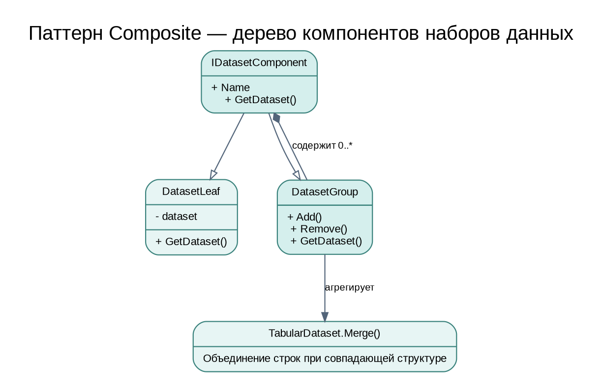
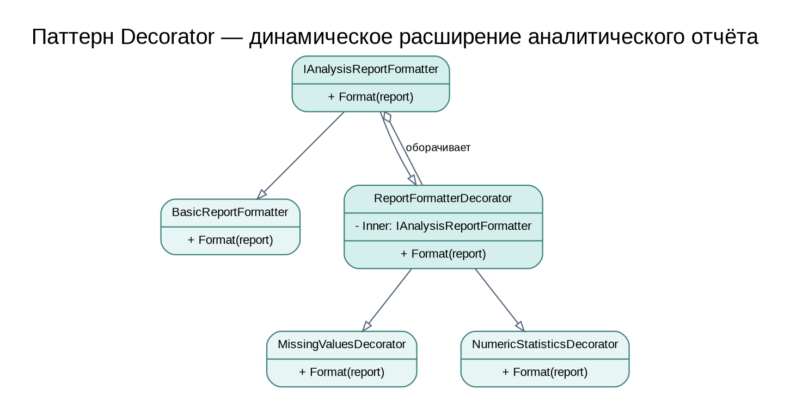

# Лабораторная работа №4

**Дисциплина:** Паттерны проектирования  
**Тема:** Структурные паттерны: Компоновщик (Composite), Декоратор (Decorator)  
**Выполнил:** Никита Фуфаев, 4 курс, группа __________  
**Проверил:** ______________________________  
**Направление подготовки:** 09.03.04 «Программная инженерия»  
**Учебное заведение:** Северо-Кавказский федеральный университет  
**Место и год:** Ставрополь, 2026 г.

**Оценка за защиту:** ____________  
**Дата защиты:** ____________  
**Подписи:** студент ____________ · преподаватель ____________

---

**Цель работы:** изучить структурные паттерны для построения древовидных композиций и динамического расширения поведения объектов.

**Задание:** реализовать решение прикладной задачи варианта с применением паттернов «Компоновщик» и «Декоратор».

**Вариант 13** — «Интерактивный анализ набора данных».

## 1. Архитектура решения

В лабораторной работе реализованы две независимые структуры. `DatasetGroup` и `DatasetLeaf` позволяют представить несколько частей набора данных в виде дерева и получить агрегированный `TabularDataset`. Цепочка форматтеров отчёта строится из базового форматтера и декораторов, дополняющих вывод сведениями о пропусках и статистикой числовых столбцов.

| Компонент | Назначение |
|---|---|
| `IDatasetComponent` | Общий интерфейс листьев и групп |
| `DatasetLeaf` | Лист дерева, содержащий отдельный набор данных |
| `DatasetGroup` | Компоновщик, содержащий другие компоненты и объединяющий их данные |
| `TabularDataset.Merge()` | Объединяет строки наборов с одинаковой структурой столбцов |
| `IAnalysisReportFormatter` | Контракт форматирования отчёта |
| `BasicReportFormatter` | Формирует базовую сводку |
| `MissingValuesDecorator` | Добавляет список столбцов с пропусками |
| `NumericStatisticsDecorator` | Добавляет min, max, среднее и медиану для числовых столбцов |

## 2. Используемые технологии

- C# 12 и .NET 8;
- композиция объектов и полиморфизм;
- общая модель `TabularDataset` и аналитический сервис;
- UML-диаграммы Composite и Decorator.

## 3. Паттерн «Компоновщик» (Composite)

Composite позволяет объединять отдельные объекты и группы объектов в древовидную структуру, обращаясь к ним через единый интерфейс. В проекте `IDatasetComponent` определяет имя компонента и метод `GetDataset()`.

`DatasetLeaf` возвращает собственный набор данных. `DatasetGroup` содержит коллекцию `IDatasetComponent`; в группу можно добавлять листья и другие группы. При вызове `GetDataset()` группа получает данные дочерних компонентов и объединяет их через `TabularDataset.Merge()`. Объединение допускается только при совпадающих именах и порядке столбцов.

| Роль | Класс / интерфейс | Ответственность |
|---|---|---|
| Component | `IDatasetComponent` | Общий интерфейс дерева |
| Leaf | `DatasetLeaf` | Представляет отдельный фрагмент данных |
| Composite | `DatasetGroup` | Хранит дочерние компоненты и агрегирует их |
| Операция объединения | `TabularDataset.Merge()` | Склеивает строки совместимых таблиц |
| Client | `Program` | Строит дерево и запрашивает итоговый набор |



*Рисунок 1 — Диаграмма классов паттерна «Компоновщик».*

Ключевой фрагмент:

```csharp
var root = new DatasetGroup("Общий набор продаж");
root.Add(new DatasetLeaf("Первая часть", firstPart));
var nested = new DatasetGroup("Вторая группа данных");
nested.Add(new DatasetLeaf("Вторая часть", secondPart));
root.Add(nested);
var combined = root.GetDataset();
```

В этой композиции корневая группа содержит лист и вложенную группу. Клиенту не нужно отдельно обрабатывать лист и контейнер.

## 4. Паттерн «Декоратор» (Decorator)

Decorator добавляет объекту новые обязанности через обёртывание, не меняя исходный класс. Базовый `BasicReportFormatter` формирует общую сводку: имя набора, количество строк и столбцов, число пропусков и процент заполненности.

`MissingValuesDecorator` дополняет сводку перечнем столбцов с пропущенными значениями. `NumericStatisticsDecorator` добавляет минимальное и максимальное значения, среднее и медиану для числовых столбцов. Декораторы реализуют общий интерфейс `IAnalysisReportFormatter` и могут комбинироваться в цепочку.

| Роль | Класс | Ответственность |
|---|---|---|
| Component | `IAnalysisReportFormatter` | Общий контракт форматирования |
| Concrete Component | `BasicReportFormatter` | Базовая аналитическая сводка |
| Decorator | `ReportFormatterDecorator` | Хранит оборачиваемый форматтер |
| Concrete Decorator | `MissingValuesDecorator` | Добавляет статистику пропусков |
| Concrete Decorator | `NumericStatisticsDecorator` | Добавляет числовые показатели |



*Рисунок 2 — Диаграмма классов паттерна «Декоратор».*

Ключевой фрагмент:

```csharp
IAnalysisReportFormatter formatter = new BasicReportFormatter();
formatter = new MissingValuesDecorator(formatter);
formatter = new NumericStatisticsDecorator(formatter);
Console.WriteLine(formatter.Format(report));
```

## 5. Контрольные данные и результат

Исходный CSV содержит 10 строк и 6 столбцов. Для демонстрации Composite строки разделяются на две части по 5 строк. Одна часть добавляется непосредственно в корневую группу, вторая — во вложенную. После обхода дерева получается исходный набор из 10 строк и 6 столбцов.

Декораторы должны вывести 2 пропуска в столбце `discount`, заполненность 96,67%, а также числовые статистики. Для `revenue`: минимум 18 000, максимум 125 000, среднее 55 850, медиана 49 000.

```text
[Composite]
Дерево компонентов: Общий набор продаж → 2 дочерних узла
Агрегированный набор: 10 строк, 6 столбцов.

[Decorator]
Пропуски по столбцам:
- discount: 2
revenue: min=18000; max=125000; среднее=55850; медиана=49000
```

## 6. Проверка корректности

- лист должен возвращать исходный набор без потери строк;
- группа должна агрегировать все дочерние компоненты, включая вложенные;
- пустая группа должна выдавать контролируемую ошибку;
- наборы с разным списком или порядком столбцов не должны объединяться;
- базовый форматтер должен формировать сводку;
- добавление декоратора пропусков и декоратора статистики должно расширять вывод, не меняя базовый форматтер.

Контрольные показатели рассчитаны по `datasets/sample_sales.csv`; фактическую компиляцию и запуск программы необходимо выполнить с .NET 8 SDK.

## 7. Вывод

Composite позволил представить несколько таблиц и их вложенные группы единообразно и агрегировать их в один набор. Decorator позволил последовательно расширять отчёт, добавляя сведения о пропусках и числовой статистике без изменения базового форматтера.

## 8. Состав папки

- `SRC/Composite/` — листья, группы и общий интерфейс;
- `SRC/Decorators/` — базовый форматтер и декораторы;
- `UML/` — диаграммы и исходники DOT;
- `assets/` — ожидаемый контрольный вывод;
- `Reports/` — формальный отчёт DOCX/PDF;
- `START_PROJECT.bat` — запуск демонстрации.
