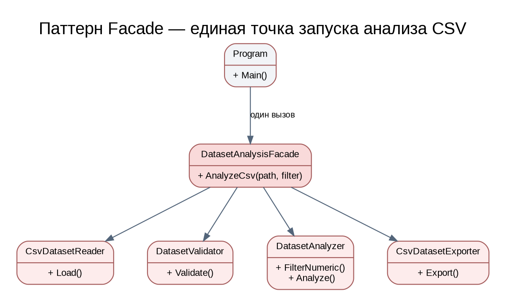
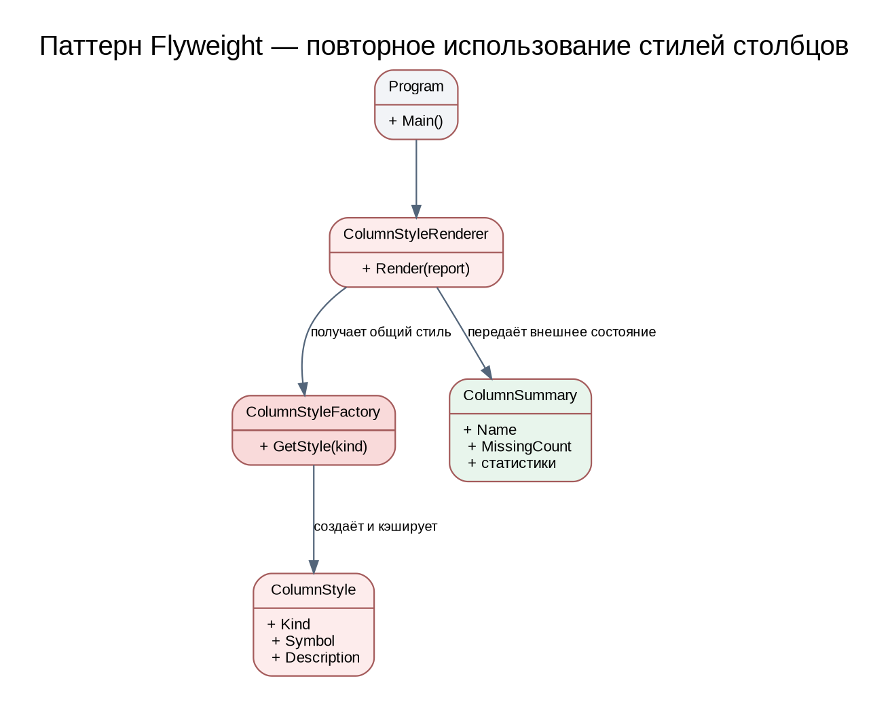

# Лабораторная работа №5

**Дисциплина:** Паттерны проектирования  
**Тема:** Структурные паттерны: Фасад (Facade), Приспособленец (Flyweight)  
**Выполнил:** Никита Фуфаев, 4 курс, группа __________  
**Проверил:** ______________________________  
**Направление подготовки:** 09.03.04 «Программная инженерия»  
**Учебное заведение:** Северо-Кавказский федеральный университет  
**Место и год:** Ставрополь, 2026 г.

**Оценка за защиту:** ____________  
**Дата защиты:** ____________  
**Подписи:** студент ____________ · преподаватель ____________

---

**Цель работы:** изучить структурные паттерны, предоставляющие упрощённый интерфейс к сложным подсистемам и позволяющие повторно использовать общее состояние множества объектов.

**Задание:** реализовать решение прикладной задачи варианта с использованием паттернов «Фасад» и «Приспособленец».

**Вариант 13** — «Интерактивный анализ набора данных».

## 1. Архитектура решения

Приложение предоставляет единый сценарий анализа CSV через `DatasetAnalysisFacade`. Фасад координирует загрузчик, валидатор, аналитический сервис и экспортёр. Для отображения типов столбцов реализован Flyweight: повторяющиеся стили хранятся в фабрике и разделяются между столбцами одного типа.

| Компонент | Назначение |
|---|---|
| `DatasetAnalysisFacade` | Координирует полный сценарий анализа CSV |
| `CsvDatasetReader` | Загружает CSV в модель `TabularDataset` |
| `DatasetValidator` | Проверяет ограничения размера и структуры |
| `DatasetAnalyzer` | Выполняет фильтрацию и расчёт статистики |
| `CsvDatasetExporter` | Формирует CSV для результата |
| `ColumnStyle` | Неизменяемый общий стиль для типа столбца |
| `ColumnStyleFactory` | Создаёт и кэширует стили по `ColumnDataKind` |
| `ColumnStyleRenderer` | Применяет общий стиль к каждому описанию столбца |

## 2. Используемые технологии

- C# 12 и .NET 8;
- `Dictionary<ColumnDataKind, ColumnStyle>` в качестве кэша;
- синхронизация доступа к кэшу через `lock`;
- общая библиотека анализа данных и экспорт CSV.

## 3. Паттерн «Фасад» (Facade)

Facade предоставляет простой интерфейс к нескольким подсистемам. Без фасада клиентскому коду пришлось бы отдельно создавать загрузчик, читать файл, проверять набор, выполнять фильтрацию, рассчитывать отчёт и формировать CSV. Такая последовательность привязала бы `Program` к внутренним деталям.

`DatasetAnalysisFacade.AnalyzeCsv()` скрывает эту последовательность за одним методом. Он загружает таблицу, выполняет проверку, при наличии фильтра применяет числовую фильтрацию, рассчитывает отчёт и подготавливает CSV-экспорт.

| Роль | Класс | Ответственность |
|---|---|---|
| Facade | `DatasetAnalysisFacade` | Единая операция `AnalyzeCsv()` |
| Subsystem | `CsvDatasetReader` | Чтение CSV |
| Subsystem | `DatasetValidator` | Проверка набора |
| Subsystem | `DatasetAnalyzer` | Фильтрация и статистика |
| Subsystem | `CsvDatasetExporter` | Экспорт обработанных данных |
| Client | `Program` | Вызывает фасад и получает готовый результат |



*Рисунок 1 — Диаграмма классов паттерна «Фасад».*

Ключевой фрагмент:

```csharp
var facade = new DatasetAnalysisFacade();
var result = facade.AnalyzeCsv(
    samplePath,
    new NumericFilter("revenue", 20000, 90000));
```

Клиент получает `FacadeAnalysisResult`, содержащий набор данных, аналитический отчёт и CSV-строку для экспорта.

## 4. Паттерн «Приспособленец» (Flyweight)

Flyweight экономит память при наличии большого количества объектов с повторяющейся частью состояния. В проекте разные столбцы могут иметь одинаковую категорию данных: числовую, текстовую, смешанную или пустую. Вместо отдельного экземпляра стиля для каждого столбца `ColumnStyleFactory` хранит один `ColumnStyle` на каждый `ColumnDataKind`.

Внутреннее состояние (intrinsic state) — тип, символ и описание стиля. Оно одинаково для всех столбцов одной категории. Внешнее состояние (extrinsic state) — имя столбца, количество пропусков и вычисленная статистика; оно передаётся рендереру при каждом вызове и не сохраняется внутри `ColumnStyle`.

| Роль | Класс | Ответственность |
|---|---|---|
| Flyweight | `ColumnStyle` | Неизменяемые общие свойства оформления |
| Flyweight Factory | `ColumnStyleFactory` | Кэширование объектов по типу столбца |
| Context | `ColumnStyleRenderer` | Применяет стиль к текущему столбцу |
| Внешнее состояние | `ColumnSummary` | Имя, пропуски и статистика отдельного столбца |
| Client | `Program` | Запрашивает стили и демонстрирует повторное использование |



*Рисунок 2 — Диаграмма классов паттерна «Приспособленец».*

Ключевой фрагмент:

```csharp
public ColumnStyle GetStyle(ColumnDataKind kind)
{
    lock (_sync)
    {
        if (_cache.TryGetValue(kind, out var existing)) return existing;
        var style = kind switch
        {
            ColumnDataKind.Numeric => new ColumnStyle(kind, "#", "Числовой столбец"),
            ColumnDataKind.Text => new ColumnStyle(kind, "Aa", "Текстовый столбец"),
            ColumnDataKind.Mixed => new ColumnStyle(kind, "A#", "Смешанные значения"),
            _ => new ColumnStyle(kind, "∅", "Пустой столбец")
        };
        _cache[kind] = style;
        return style;
    }
}
```

Блокировка `lock` защищает общий словарь при конкурентном доступе. Встроенный `switch` создаёт объект стиля только при первом обращении к соответствующему типу данных.

## 5. Результат работы программы

При нажатии Enter на приглашениях консольной программы используются значения по умолчанию: столбец `revenue`, минимум 20 000 и максимум 90 000. По демонстрационным данным фильтр оставляет 8 из 10 записей. В полученной таблице остаётся 1 пропущенная ячейка, заполненность равна 97,92%.

В результате анализа 6 столбцов имеют два разных типа: числовой и текстовый. Поэтому `ColumnStyleFactory` создаёт два общих экземпляра стиля, а повторный запрос стиля для числового столбца должен вернуть тот же объект.

```text
[Facade]
Один вызов выполнил загрузку, проверку, фильтрацию, анализ и подготовку CSV.
Итог: 8 строк; заполненность=97.92%.

[Flyweight]
Один объект стиля для одинакового типа: True
Создано общих стилей: 2; столбцов в отчёте: 6.
```

## 6. Проверка корректности

- фасад должен возвращать набор, отчёт и CSV-экспорт;
- неизвестный столбец или некорректный диапазон должен отклоняться аналитическим сервисом;
- одинаковый `ColumnDataKind` должен возвращать один и тот же `ColumnStyle`;
- разные типы данных должны получать разные стили;
- `CreatedCount` должен соответствовать количеству реально созданных видов стиля;
- внешние данные столбца не должны храниться в объекте Flyweight.

Контрольные значения рассчитаны по `datasets/sample_sales.csv`. .NET SDK отсутствует в среде упаковки, поэтому фактический запуск консольной программы нужно подтвердить на ПК с .NET 8 SDK.

## 7. Вывод

Фасад объединил действия нескольких сервисов в одну понятную операцию анализа CSV. Приспособленец обеспечил повторное использование неизменяемых объектов оформления для столбцов одинакового типа, отделив общее внутреннее состояние от данных конкретного столбца.

## 8. Состав папки

- `SRC/Facade/` — фасад и результат анализа;
- `SRC/Flyweight/` — кэш стилей и рендерер;
- `UML/` — диаграммы и исходники DOT;
- `assets/` — контрольный ожидаемый вывод;
- `Reports/` — формальный отчёт DOCX/PDF;
- `START_PROJECT.bat` — запуск демонстрации.
